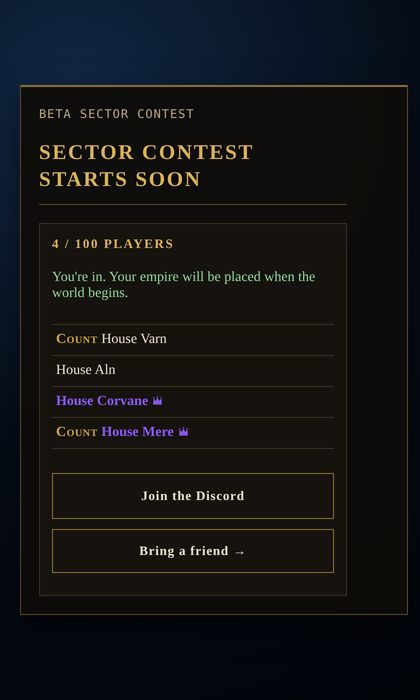
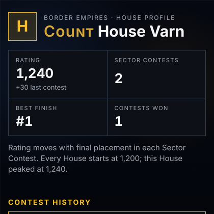
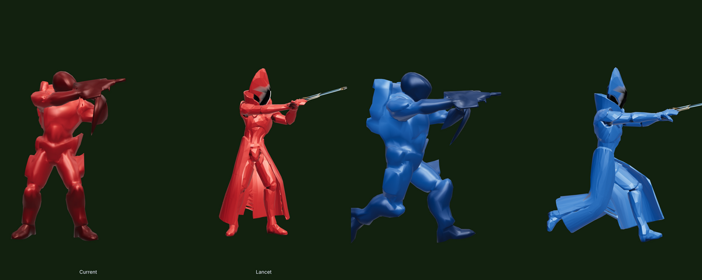

# Account cosmetics

Status: canonical reference
Owner: Border Empires maintainers
Last verified: 2026-11-27

The product decisions are in [`gdd.md`](gdd.md) §8. This page describes what
is built and the rules new cosmetics must follow.

## The rule every cosmetic must pass

**Money never buys power.** A cosmetic changes only how something looks. It
must not change visibility, hit areas, or what a rival can read from the thing
it decorates.

| Thing | A rival must still read | So a cosmetic may change | And may not change |
|---|---|---|---|
| Muster flag | Owner (colour), ADVANCE or not (brighter cloth, faster wind), strength (soldier count) | The embroidery on the cloth; added ornament in gold and in the owner's colour | The cloth's outline, its wind, the owner colour as the field, how much of the field shows, the soldiers, the siege ring, the progress badge |
| Ancillaries (soldiers) | Owner (colour), how many stand and fall, their stance, shots, and a Titanium Weapons Factory (heavy armour) | The soldier model, on the same rig, clips and tint, up to about 12% taller (the Lancet guard's hood) | Their number, poses, timing, shot colour, Umbrite rounds, and the titanium look: **with a Titanium Weapons Factory every ancillaries look must have a titanium version** (bulky plate edged in bare metal, like the heavy armour), which `marineModelFor` picks, so a rival still sees that strength |

Added ornament must stay inside the tile, close to the standard plinth's
footprint, and within 15% of the standard flag's height
(`muster-banner-regalia-geometry.test.ts`), so a paid flag is grander but not
a taller beacon.

No design may cover more of the owner's colour than the standard look does.
Picking is by map tile, not by the drawn object, so no cosmetic affects a hit
area.

## What exists

| Id | Slot | Working title | Look |
|---|---|---|---|
| `ancillaries-lancet-guard` | `ancillaries` | Lancet guard | A House guard in a long coat and tall hooded helm, in the owner's colour, with a black faceplate split by a white sight slit and a slim rifle with a blue-lit barrel, baked into the model and skinned to the right hand like the standard marine's. With a Titanium Weapons Factory: the same guard in titanium plate, with massive pauldrons, armoured forearms and greaves, every plate edged in bare titanium |
| `flag-high-noble` | `musterFlag` | High-noble standard | A gilded standard: a slowly turning aureole of gold rays inside a studded halo that turns the other way, round a glowing, pulsing gem in the owner's colour, with a soft gold glow behind it; gilded wings spread from the crossbar; two swallow-tailed streamers in the owner's colour from each end of the crossbar, edged and banded in gold, rippling in the wind; four tall gold posts topped with glowing gems and joined by gold chains inside a double gold rim on the plinth; a sheen that sweeps up the gold, glints that twinkle on it, and gold dust drifting up round the flag; and a gold-bordered damask cloth with a scalloped pelmet and a sun in splendour, its gold thread shining as metal with a glint running down it |

The muster flag came first (owner decision, 2026-11-24): the muster flag,
soldiers and AFC are a House's own property. The owner then picked the Lancet
guard as a paid ancillaries look. A colour scheme and beacon skin are not
built.

Ids are stored and sent on the wire, capped at 24 characters: never rename
one. The labels above are what Settings shows; the shop sells products. The
catalogue is `packages/shared/src/cosmetics/cosmetics.ts`.

### What the shop sells

Owner decisions, 2026-11-25:

| Product id | Shop name | Price | Grants | Title |
|---|---|---|---|---|
| `title-count` | Claim the title of Count | USD 4.99, one-time | `flag-high-noble` and `ancillaries-lancet-guard` | Count |

Products live in `COSMETIC_PRODUCTS` beside the catalogue. Ownership is still
stored per cosmetic, so a product is only a list of grants; taxes and other
currencies are the payment provider's.

**The title.** An account that owns everything a titled product grants holds
its title (`accountTitleFor`); revoking one of the cosmetics (a refund) takes
it away. "Count" is shown in gold small caps before the House name:

- on the contest lobby roster (`SEASON_LOBBY_UPDATE` and `INIT` roster
  entries carry `title`; `client-season-lobby-panel.ts`), and
- on the public House profile (`GET /public/house/:id` carries `title`;
  `client-public-house-view.ts`).

It is not shown in a match (leaderboard, tile owner, chat). The roster entry
is refreshed when the player next checks in or changes their flag, and the
public profile within its one-minute cache. Unknown titles are dropped by the
client (`isAccountTitle`).

On the contest roster (beside a Duke's purple name and crown) and on the
public profile, at phone width:

### Where it is drawn

| | True-3D | 2D canvas |
|---|---|---|
| Muster flag | Every visible flag: the cloth livery (`muster-banner-cloth-material.ts`, per-flag `aBannerDesign`) and the regalia (`muster-banner-regalia.ts`, with its geometry, materials and effects beside it) | Only the pennant on your own besieged flag, which gains a gold edge, sun and finial (`client-map-render-muster-siege-badge.ts`) |

Known gaps:

- **The 2D map draws no muster flag for rivals, standard or not**, so a rival
  on the 2D map does not see the High-noble standard. Drawing one would change
  what 2D players can read and is a gameplay decision, not a cosmetic one.
- It is built in code in the map's low-poly style, like the standard banner.
  A sculpted, textured model would need an artist and a model pipeline.
- The streamers cast no shadow, because they move in their shader.
- The look must not be mistaken for the earned Duke title. It uses no crown.
- Cost: about 3,800 triangles per High-noble flag, eight more draw calls for
  all such flags together, and two matrices per such flag per frame for the
  turning aureole and halo. Streamers, sparkles, glow, dust, the gold sheen and
  the cloth glint animate in their shaders. A standard flag costs nothing
  extra. Not profiled on a phone.
- The glow, sparkles and dust are drawn additively, so they show more at
  night. They sit on the flag's own tile, which a rival sees only with vision
  of it.

Review story: `Map/Combat/Muster/Flag Designs` in Storybook.

### Standard and High-noble, side by side

Captured from that story on 2026-11-24. The standard flag is the back row
(upper row in 2D).

In ADVANCE both designs brighten the same way:

At map distance:

2D pennant:

## The Lancet guard

| | True-3D | 2D canvas |
|---|---|---|
| Ancillaries | Every soldier a House fields: battles and skirmishes, capture-hold garrisons, marches from a muster flag, and its expand crew. `withSquadSkin` (`client-cosmetics.ts`) adds the owner's choice to the squad gear at each gear lookup in `client-battle-overlay.ts`, `client-map-3d-muster-transit-sync.ts` and `client-map-3d-expand-crew.ts`; `marineModelFor` picks the model | Not drawn: the 2D map draws no soldiers for anyone |

- Models: `packages/client/public/models/popup-marine-lancet-24bone.glb` and,
  for Houses with a Titanium Weapons Factory,
  `popup-marine-lancet-titan-24bone.glb` (each about 5,000 triangles,
  1.3 MB, like the heavy armour; the titanium one is baked with `--titan`). Built from a Meshy
  sculpt and rifle by `packages/client/scripts/bake-popup-marine-lancet-model.py`
  then `retarget-popup-marine-heavy-clips.py`; the asset test checks its rig,
  clips and size like the other two.
- Height 0.058 against the standard marine's 0.052 (owner request, 2026-11-24): about 12% taller, hood included. Soldiers are picked by tile, so this changes no hit area, and their count and spacing are unchanged.
- Loaded only once a House showing it is on screen. No extra cost per soldier
  over the heavy armour.
- Not drawn: salvage-delivery ancillaries (`client-map-3d-salvage-ancillaries.ts`)
  stay standard; they belong to no House's squad.
- Known flaws at close range: the back of the coat stretches a little when
  kneeling, and the Meshy sculpt's gold trim was too faint to keep.
- Lore reviewed; no canon change. Ancillaries are a House's remade bodies run
  by its AI (`lore/galactic-lore.md`); this is a guard livery on them, not a
  different kind of soldier.

Review stories: `Map/Combat/Popup Marines/Skirmish`, `Lancet Guard` and
`Lancet Guard Under Titanium`.

The standard marine and the Lancet guard, idle and running (viewer renders):

Kneeling and up close:

Heavy armour, the Lancet guard and the titanium Lancet guard:

In the game's renderer, Lancet guards (blue) against standard marines (red),
and with a Titanium Weapons Factory blue's guards wear titanium plate:

## House crests

Owner decision, 2026-11-27: build a crest picker now, free, so a House's
emblem stops being only its initial in a coloured square. Paid crests may
come later.

- **Catalogue.** `packages/shared/src/cosmetics/crest-cosmetics.ts`, slot
  `crest`, 12 crests: cog, anchor, tower, lighthouse, airship, crossed
  spanners, gear-wing, key, compass, kraken, stag and hammer. Every entry has
  `free: true`. There is no crown, which would read as the earned Duke title.
- **Free cosmetics.** A `free` cosmetic is owned by every account without a
  grant: the gateway adds every free id to `COSMETICS_STATE.owned`
  (`ownedWithFreeCosmetics`) and accepts `SET_COSMETIC` for it without a
  stored grant. Free cosmetics are never written to `account_cosmetics_owned`
  and never count towards a title. Admin grant and revoke ignore a free id
  (they answer `ok` and change nothing), so a revoke cannot clear a crest. To sell a crest later, add it without
  `free` and grant it like any other cosmetic.
- **Once per Sector Contest** (owner decision, 2026-11-27). Like the name and
  colour, a House can change its crest once per contest, the first pick from
  the letter included. The gateway records the contest of each crest change in
  `account_cosmetics_slot_changes` and refuses a second with `COSMETIC_LIMIT`
  ("Crest already changed this contest."); `COSMETICS_STATE.crestChangeUsed`
  tells the client. Name and colour use `nameChangedSeasonId` /
  `colorChangedSeasonId` on the profile row (`profile-change-allowance.ts`;
  `SET_PROFILE` and `SET_TILE_COLOR` both enforce the colour limit). The Edit
  dialog labels each field ("Name · 1 change left", "Crest · used"), disables
  a used one and lists every change, crest included, on the confirm.
- **Art.** `packages/client/src/client-house-crest/client-house-crest-art.ts`:
  one bold silhouette per crest on a 24-unit grid in `currentColor`, outlined
  by a CSS drop shadow so it reads on light House colours. Built to the
  steampunk icon rule: simple and legible at 16 to 24 px.
- **What a rival must still read.** The emblem's field stays the House
  colour, and the crest takes the place of the letter, never more space. On
  a muster flag the crest replaces the device inside the same square: the
  cloth's colour, outline, wind, ADVANCE cues and soldiers are unchanged. On
  the 16 px Chronicle emblem a crest is harder to tell apart than a letter;
  the House name always sits beside the emblem.
- **Choosing.** Name, colour and crest are set together in one dialog,
  "Edit Name, Colour & Crest" (`client-hud-profile-edit-overlay.ts`, crest
  part in `client-profile-edit-crest.ts`): a live preview of your emblem in
  the chosen colour and crest above the crest picker (owner, 2026-11-27).
  Open it by tapping the emblem on your own profile (tap your HUD emblem
  first to open the profile), or from Settings → Account. "Letter" clears the
  crest. Save sends `SET_COSMETIC` after any name or colour change, and the
  dialog stays open on "Saving…" until the gateway answers with
  `COSMETICS_STATE`; a `COSMETIC_*` refusal naming the `crest` slot (the
  gateway's `COSMETIC_*` errors carry `slot`) or no reply in 15 s is shown in
  the dialog. A crest-only change skips the once-per-contest confirmation,
  since a crest can change at any time; with a name or colour change, the
  confirmation lists only the name and colour. If the name or colour is
  refused, the crest is still saved and the dialog shows both outcomes
  ("Name taken · Crest saved"). The Settings cosmetics card no longer offers
  crests.

| Emblem | Shows the crest |
|---|---|
| Your HUD emblem (`client-hud-v2-nav.ts`) | Yes |
| Rivals strip (`client-hud-v2-rivals.ts`) | Yes |
| Diplomacy list and requests (`client-hud-v2-diplomacy.ts`) | Yes |
| Ranks race pins and standings (`client-hud-v2-ranks.ts`) | Yes; a House without a crest keeps its one or two letters |
| Chronicle rivals (`client-hud-v2-chronicle.ts`) | Yes |
| Battle sides (`client-hud-v2-battle.ts`) | Yes |
| Profile hero (`client-hud-v2-profile.ts`) | Yes |
| Public House web page (`client-public-house-view.ts`) | No: `GET /public/house/:id` does not carry the crest yet |
| Muster flags, true-3D | Every visible flag, yours and rivals': the crest is stitched on the cloth in place of the cog (or the High-noble sun), in the same thread with the same dark outline. Crests are rasterised once into a 4×3 atlas (`muster-banner-crest-atlas.ts`); `aBannerCrest` per flag picks the cell. A flag keeps its cog (or sun) until its crest's cell has loaded, and for good if the image fails twice. A flag with no crest keeps its cog. Relic banners keep the cog. A crest or flag change redraws the flags at once (`cosmeticsRevision` in `client-map-3d-rebuild-triggers.ts`) |
| Muster flags, 2D canvas | Your own besieged flag's pennant (the only muster flag 2D draws, see the known gap above) carries your crest in place of the High-noble sun once tiles are drawn 48 px or larger (`client-map-render-muster-siege-badge.ts`); smaller, the pennant stays plain. Rivals' flags are not drawn on the 2D map for anyone |

AI Houses show their letter: nothing picks a crest for them.

## Ownership and selection

- The account key is the gateway player id, which is the same in every Sector
  Contest on a server.
- Tables (gateway SQLite, created by `SqliteAccountCosmeticsStore.applySchema`):
  `account_cosmetics_owned(player_id, cosmetic_id, granted_at, grant_ref)` and
  `account_cosmetics_selected(player_id, slot, cosmetic_id, updated_at)`.
- An account with no row in `account_cosmetics_selected` shows the standard
  look.

**Each server has its own database, and a hosted sector is its own server.**
"Bought once, shown everywhere" therefore needs the hosted-sector work to
either grant on every server an account plays on or replace
`AccountCosmeticsStore` with a central store. Nothing here does that yet.

### Granting

`AccountCosmeticsService.grant(playerId, cosmeticId, grantRef)` in
`apps/realtime-gateway/src/account-cosmetics/account-cosmetics-service.ts` is
the only way an account comes to own a cosmetic. It is idempotent. `revoke`
takes a cosmetic back and returns everyone's view to the standard look. No
client message reaches either.

- **Payment work:** the hosting service (`apps/sector-control`) takes the
  payment and knows the buyer by Firebase uid. It calls
  `POST /admin/cosmetics/purchase-grant` and, on a refund or withdrawal,
  `POST /admin/cosmetics/purchase-revoke`, body `{"uid", "productId", "grantRef"?}`
  (the payment id as `grantRef`). The gateway resolves the uid to the player id
  through the auth binding store and calls `grantProduct`, which grants every
  cosmetic in the product and is idempotent; revoking removes every cosmetic of
  the product, and with them the title. An account that has never entered the
  game answers 404 `no_player`, and the hosting service tries again later.
  These two routes accept only `Authorization: Bearer $COSMETICS_GRANT_TOKEN`
  (at least 32 characters; without it they do not exist), a key that can do
  nothing else, so the hosting service never holds `ADMIN_API_TOKEN`
  (owner decision, 2026-11-28).
- **Testing and support:** `POST /admin/cosmetics/grant` and
  `POST /admin/cosmetics/revoke`, body `{"playerId", "cosmeticId", "grantRef"?}`,
  and `POST /admin/cosmetics/grant-product`, body
  `{"playerId", "productId", "grantRef"?}`.
  They accept only `Authorization: Bearer $ADMIN_API_TOKEN`; no player session,
  query-string token or Firebase sign-in is accepted.

### Client messages

| Direction | Message | Meaning |
|---|---|---|
| Client → gateway | `REQUEST_COSMETICS` | What do I own and show? Sent once per session, on the first HUD render with a live session, not at login |
| Client → gateway | `SET_COSMETIC {slot, cosmeticId \| null}` | Show this owned cosmetic; `null` is the standard look. Refused with `COSMETIC_NOT_OWNED` or `COSMETIC_INVALID` |
| Gateway → that client | `COSMETICS_STATE {owned, selected}` | Reply to both, and pushed when a grant or revoke lands |
| Gateway → everyone | `PLAYER_STYLE {playerId, cosmetics}` | A player's look changed; `{}` is the standard look |
| Gateway → joining client | `INIT.playerCosmetics` | The non-default looks of the players in the current world, the joining player and the pending contest's lobby. Absent when there is none |

Settings → Account shows a cosmetics card to every account: it always has
the House crest picker, plus a row per other slot the account owns something
for.

## Wire and memory cost

- A player who shows no cosmetic (no crest either) adds **no bytes** to
  `INIT` or to any broadcast.
- `COSMETICS_STATE.owned` always lists the 12 free crest ids, about 200
  bytes, once per session to that player only.
- A non-default look is one short id per slot, about 45 bytes as JSON today. A
  change is one broadcast, serialised once and shared by every recipient.
- The gateway keeps one small object per account with a non-default look
  (`shown` in the service), loaded once at boot, in two sets with their own
  limits: accounts showing a paid cosmetic (5,000,
  `MAX_LOADED_COSMETIC_SELECTIONS`) and accounts showing only free crests
  (20,000, `MAX_LOADED_FREE_COSMETIC_SELECTIONS`), so free crests never push
  a paid look out. Past a limit a choice is still saved but other players see
  the old look, and a counter records it.
- `INIT.playerCosmetics` lists only the players this client can meet: the
  current world's players, the joining player and the pending contest's
  lobby (`init-cosmetics.ts`), so it grows with the world, not with every
  account the server has seen.
- Nothing is stored in the simulation, its checkpoints or its events.
- Metrics: `gateway_account_cosmetics_owned`, `_selected`, `_shown_accounts`,
  `_shown_free_only_accounts`, `_catalog_size` and `_shown_cap_rejections_total`.

## Account deletion

Both tables are `PERSONAL_TABLES` in
`scripts/account-deletion/erase-account-data.mjs`: the rows are deleted with
the account. Payment records are a separate matter for the payment work. See
[`agents/account-deletion.md`](agents/account-deletion.md).

## Adding a cosmetic

1. Add it to `COSMETIC_CATALOG`. A new slot also goes in `COSMETIC_SLOTS` and
   `PlayerCosmeticSelection`. Set `free: true` only if every account should
   own it without paying.
2. Give it a look in **both** renderers, or disclose the gap in the table
   above. A flag design needs an index in `BANNER_DESIGN_INDEX`, which is
   typed so a catalogue id without a look does not compile.
3. Check it against the rule table at the top, and add it to the side-by-side
   story.
4. Read [`lore/README.md`](lore/README.md): a look or name that says something
   new about the world needs a canon update.
