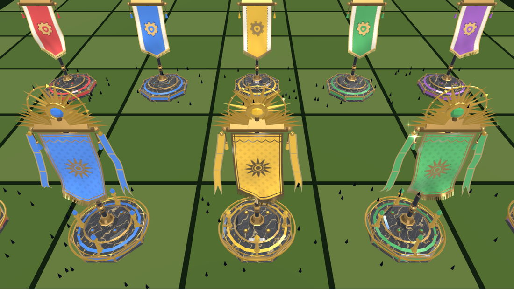
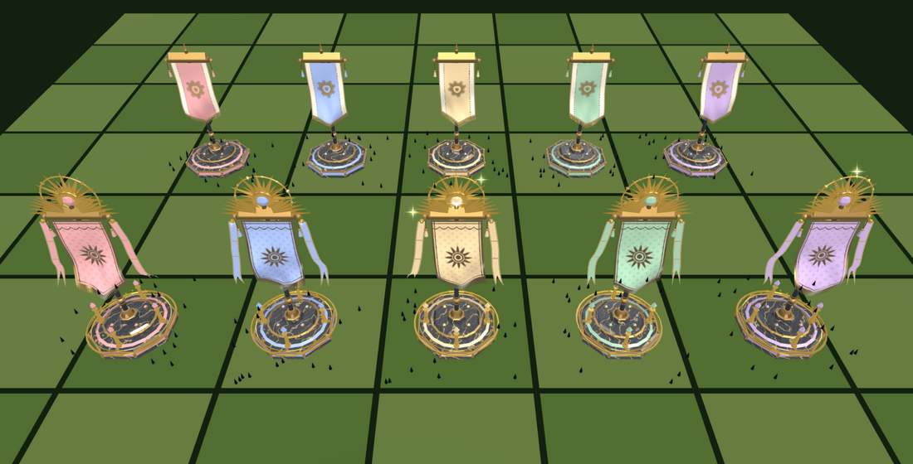

# Account cosmetics

Status: canonical reference
Owner: Border Empires maintainers
Last verified: 2026-11-24

The product decisions are in [`gdd.md`](gdd.md) §8. This page describes what
is built and the rules new cosmetics must follow.

## The rule every cosmetic must pass

**Money never buys power.** A cosmetic changes only how something looks. It
must not change visibility, hit areas, or what a rival can read from the thing
it decorates.

| Thing | A rival must still read | So a cosmetic may change | And may not change |
|---|---|---|---|
| Muster flag | Owner (colour), ADVANCE or not (brighter cloth, faster wind), strength (soldier count) | The embroidery on the cloth; added ornament in gold and in the owner's colour | The cloth's outline, its wind, the owner colour as the field, how much of the field shows, the soldiers, the siege ring, the progress badge |

Added ornament must stay inside the tile, close to the standard plinth's
footprint, and within 15% of the standard flag's height
(`muster-banner-regalia-geometry.test.ts`), so a paid flag is grander but not
a taller beacon.

No design may cover more of the owner's colour than the standard look does.
Picking is by map tile, not by the drawn object, so no cosmetic affects a hit
area.

## What exists

| Id | Slot | Working title | Look |
|---|---|---|---|
| `flag-high-noble` | `musterFlag` | High-noble standard | A gilded standard: a slowly turning aureole of gold rays inside a studded halo that turns the other way, round a glowing gem in the owner's colour; gilded wings spread from the crossbar; a long swallow-tailed streamer in the owner's colour from each end of the crossbar, edged and banded in gold, rippling in the wind; four tall gold posts topped with glowing gems and joined by gold chains inside a double gold rim on the plinth; glints that twinkle on the gilding; and a gold-bordered damask cloth with a scalloped pelmet and a sun in splendour, its gold thread shining as metal with a glint running down it |

One cosmetic for now (owner decision, 2026-11-24): the muster flag is a
House's own property and the thing to make grand. An ancillary skin, colour
scheme and beacon skin are not built.

Ids are stored and sent on the wire: never rename one. The working titles are
placeholders; the owner sets shop names and prices. The catalogue is
`packages/shared/src/cosmetics/cosmetics.ts`.

### Where it is drawn

| | True-3D | 2D canvas |
|---|---|---|
| Muster flag | Every visible flag: the cloth livery (`muster-banner-cloth-material.ts`, per-flag `aBannerDesign`) and the regalia (`muster-banner-regalia.ts`, with its geometry and materials beside it) | Only the pennant on your own besieged flag, which gains a gold edge, sun and finial (`client-map-render-muster-siege-badge.ts`) |

Known gaps:

- **The 2D map draws no muster flag for rivals, standard or not**, so a rival
  on the 2D map does not see the High-noble standard. Drawing one would change
  what 2D players can read and is a gameplay decision, not a cosmetic one.
- It is built in code in the map's low-poly style, like the standard banner.
  A sculpted, textured model would need an artist and a model pipeline.
- The streamers cast no shadow, because they move in their shader.
- The look must not be mistaken for the earned Duke title. It uses no crown.
- Cost: about 3,300 triangles per High-noble flag, six more draw calls for
  all such flags together, and two matrices per such flag per frame for the
  turning aureole and halo. Streamers, sparkles and the cloth glint animate in
  their shaders. A standard flag costs nothing extra.

Review story: `Map/Combat/Muster/Flag Designs` in Storybook.

### Standard and High-noble, side by side

Captured from that story on 2026-11-24. The standard flag is the back row
(upper row in 2D).

In ADVANCE both designs brighten the same way:

At map distance:

2D pennant:

## Ownership and selection

- The account key is the gateway player id, which is the same in every Sector
  Contest on a server.
- Tables (gateway SQLite, created by `SqliteAccountCosmeticsStore.applySchema`):
  `account_cosmetics_owned(player_id, cosmetic_id, granted_at, grant_ref)` and
  `account_cosmetics_selected(player_id, slot, cosmetic_id, updated_at)`.
- An account with no row in `account_cosmetics_selected` shows the standard
  look.

**Each server has its own database, and a hosted sector is its own server.**
"Bought once, shown everywhere" therefore needs the hosted-sector work to
either grant on every server an account plays on or replace
`AccountCosmeticsStore` with a central store. Nothing here does that yet.

### Granting

`AccountCosmeticsService.grant(playerId, cosmeticId, grantRef)` in
`apps/realtime-gateway/src/account-cosmetics/account-cosmetics-service.ts` is
the only way an account comes to own a cosmetic. It is idempotent. `revoke`
takes a cosmetic back and returns everyone's view to the standard look. No
client message reaches either.

- **Payment work:** call `grant` from the webhook handler after verifying the
  provider's signature, with the payment id as `grantRef`.
- **Testing and support:** `POST /admin/cosmetics/grant` and
  `POST /admin/cosmetics/revoke`, body `{"playerId", "cosmeticId", "grantRef"?}`.
  They accept only `Authorization: Bearer $ADMIN_API_TOKEN`; no player session,
  query-string token or Firebase sign-in is accepted.

### Client messages

| Direction | Message | Meaning |
|---|---|---|
| Client → gateway | `REQUEST_COSMETICS` | What do I own and show? Sent once per session, on the first HUD render with a live session, not at login |
| Client → gateway | `SET_COSMETIC {slot, cosmeticId \| null}` | Show this owned cosmetic; `null` is the standard look. Refused with `COSMETIC_NOT_OWNED` or `COSMETIC_INVALID` |
| Gateway → that client | `COSMETICS_STATE {owned, selected}` | Reply to both, and pushed when a grant or revoke lands |
| Gateway → everyone | `PLAYER_STYLE {playerId, cosmetics}` | A player's look changed; `{}` is the standard look |
| Gateway → joining client | `INIT.playerCosmetics` | Every account with a non-default look. Absent when there is none |

Settings → Account shows a cosmetics card only to an account that owns
something.

## Wire and memory cost

- A player who owns nothing adds **no bytes** to `INIT` or to any broadcast.
- A non-default look is one short id per slot, about 45 bytes as JSON today. A
  change is one broadcast, serialised once and shared by every recipient.
- The gateway keeps one small object per account with a non-default look
  (`shown` in the service), loaded once at boot. It is limited to 5,000
  accounts (`MAX_LOADED_COSMETIC_SELECTIONS`); past that a choice is still
  saved but other players see the standard look, and a counter records it.
- `INIT.playerCosmetics` lists every such account on the server, whether or
  not it is in the current contest. At the limit that is about 250 KB per
  login. If a server ever approaches that, filter the list to the contest's
  players.
- Nothing is stored in the simulation, its checkpoints or its events.
- Metrics: `gateway_account_cosmetics_owned`, `_selected`, `_shown_accounts`,
  `_catalog_size` and `_shown_cap_rejections_total`.

## Account deletion

Both tables are `PERSONAL_TABLES` in
`scripts/account-deletion/erase-account-data.mjs`: the rows are deleted with
the account. Payment records are a separate matter for the payment work. See
[`agents/account-deletion.md`](agents/account-deletion.md).

## Adding a cosmetic

1. Add it to `COSMETIC_CATALOG`. A new slot also goes in `COSMETIC_SLOTS` and
   `PlayerCosmeticSelection`.
2. Give it a look in **both** renderers, or disclose the gap in the table
   above. A flag design needs an index in `BANNER_DESIGN_INDEX`, which is
   typed so a catalogue id without a look does not compile.
3. Check it against the rule table at the top, and add it to the side-by-side
   story.
4. Read [`lore/README.md`](lore/README.md): a look or name that says something
   new about the world needs a canon update.
